# WAE RTTY Intel

**A live band / beam / multiplier assistant for the WAE DX Contest RTTY.**
It merges the Reverse Beacon Network, DX clusters, your N1MM Logger+ log and the Contest Online
Scoreboard into one browser dashboard that answers the questions you ask yourself all night:
*which band, which heading, which multiplier, who can I still send QTCs to, how much do I need to pass
the next station, and how much operating time do I have left?*

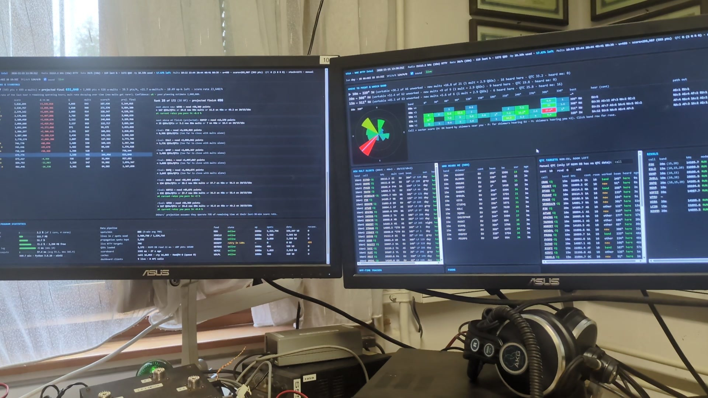
<sub>The dashboard running at the S51A contest station during WAE DX Contest RTTY 2026 (operator S58Q).</sub>

  

---

## Contents

- [Why this exists](#why-this-exists)
- [Features](#features)
- [Screenshots](#screenshots)
- [How it works](#how-it-works)
- [Requirements](#requirements)
- [Quick start](#quick-start)
- [Try it without a radio (demo mode)](#try-it-without-a-radio-demo-mode)
- [Installation, step by step](#installation-step-by-step)
- [Connecting N1MM Logger+](#connecting-n1mm-logger)
- [Configuration reference](#configuration-reference)
- [Using the dashboard](#using-the-dashboard)
- [Command line](#command-line)
- [Open it on a phone or tablet](#open-it-on-a-phone-or-tablet)
- [Troubleshooting](#troubleshooting)
- [Known limitations](#known-limitations)
- [Field report: WAE RTTY 2026 at S51A](#field-report-wae-rtty-2026-at-s51a)
- [Project layout](#project-layout)
- [Development](#development)
- [Credits and data sources](#credits-and-data-sources)
- [Contest rules and fair use](#contest-rules-and-fair-use)
- [License](#license)

---

## Why this exists

WAE RTTY is not a normal "work everyone" contest:

- **Weighted band multipliers** — every country counts again on every band, and 80 m is worth ×4,
  40 m ×3, 20/15/10 m ×2. One new 80 m multiplier can be worth as much as a dozen QSOs.
- **Call areas are multipliers** — W1…W0, VE1…, JA1…JA0, VK, ZL, ZS, BY, PY and RA8/9/0 each count
  separately, so a good opening to North America or Japan is full of multipliers.
- **QTCs** — QSOs you have already made can be passed to stations on *other* continents (max. 10 per
  station pair) and every QTC is worth a point, exactly like a QSO.
- **The 36-hour rule** — single operators may only operate 36 of the 48 hours, in off periods of at
  least 60 minutes.

A spot list or a band map shows *what* is on the air. It does not tell you whether *you* can hear it from
your location, what it is worth in WAE scoring, or which way to turn the beam. This program does that,
continuously, from live data. It was built the evening before WAE RTTY 2026 and used through the whole
contest at the **S51A** club station — see the [field report](#field-report-wae-rtty-2026-at-s51a).

## Features

**Where to point & which band**
- Band × direction heatmap (30° sectors by default) built from three kinds of live evidence:
  1. **H** – DX stations decoded by skimmers *near you* (≈ what you can hear),
  2. **P** – far skimmers decoding stations *near you* (the path out of your area is open),
  3. **M** – skimmers decoding **your own call** (the strongest evidence, counted double).
- Best heading per band (signal-weighted average inside the best sector) and a ranked
  "▶ go here" line: band → heading → how many workable stations and multipliers it offers.
- CW skimmer data is used for propagation as well (there are many more CW than RTTY skimmers);
  alerts and targets stay RTTY-only.
- Polar beam chart per band.

**"Can I actually work it?" weighting**
Every spotted station gets a 0–1 audibility score, shown in the *heard* column:

| label | score | meaning |
|---|---|---|
| `here` | 1.0 | decoded by a skimmer within `near_km` of you |
| `path` | 0.25–0.7 | the band is open from your area in that direction (0.7 if skimmers there decode you) |
| `short` / `short?` | 0.6 / 0.35 | nearby station on 80/40 m (`?` = 40 m at night, when close stations are often in the skip zone) |
| `1-hop?` | 0.4 | 700–1200 km away on 20/15/10 m |
| `skip` | 0.1 | too close for 20/15/10 m |
| `far` | 0.05 | only heard far away from you (e.g. US skimmers hearing US stations) — greyed out |

Without this, a band full of multipliers that only *other* continents can hear would be recommended.

**Real WAE scoring**
- Score = (QSOs + QTCs) × weighted multipliers; dupes score nothing.
- A new multiplier on band *b* is worth `weight(b) × points / weighted_mults` QSOs — so its value grows
  as your log grows. Until you have operated 3 h, your `expected_final_*` estimates are used.
- Multipliers follow the WAE list: DXCC entities, WAE-only entities (`*IT9`, `*GM/s`, `*JW/b`, `*TA1`,
  `*4U1V`) and the call areas above.

**Panels**
- **New mult alerts** — unworked multipliers on each band, sorted by value × audibility, with short/long
  path heading, day/greyline/night at the DX, SNR, number of skimmers. Beeps for a *workable* new 80/40 m
  multiplier seen by ≥2 skimmers (single-skimmer spots can be busted calls).
- **Who hears me (RBN)** — every skimmer decoding your call: band, continent, heading, distance, SNR.
- **QTC targets** — non-EU stations active right now that still have QTC room (10 − sent − received).
- **Rivals** — your competitors' band, frequency, RUN/S&P, which continents hear them, score and rate.
  Pulled **automatically from the scoreboard** (top N of your category + N above and below you).
- **Projected score & standings** — your projected final score, your rank and projected finish, and
  for the next station up and each rival: *how much to get ahead* expressed as QSOs/QTCs or as new
  80/40/20 m multipliers, and the hours until you pass them at current rates.
- **Off-time tracker** — 36 h budget, every off period counted, the current gap turns green once it
  counts as off (≥60 min).
- **Computer & program statistics** — CPU, RAM, event-loop lag, dashboard compute time, spots/min,
  per-feed status and data volume, N1MM database read time, scoreboard response time.
- **Lookup** — any call: country, multiplier, heading, distance, sun state, bands worked, QTC count,
  where it is active right now.

**Station control**
- **Click a call → N1MM tunes the radio there** (N1MM's `radio_setfrequency` UDP command). Refused
  while you are transmitting.
- Optional **beam turning** through PstRotator or N1MM Rotor.

**Robustness**
- Every feed reconnects on its own; identical spots from several feeds are counted once.
- N1MM database is read **read-only**; a wrong or empty database never wipes the live log.
- Runs for a whole contest on modest hardware (2.5 % of one core and ~120 MB RAM on a Windows 7 PC
  after 24 h in 2026).

## Screenshots

| | |
|---|---|
| 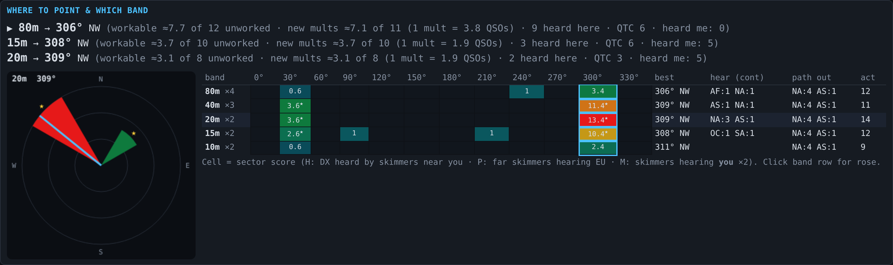 | 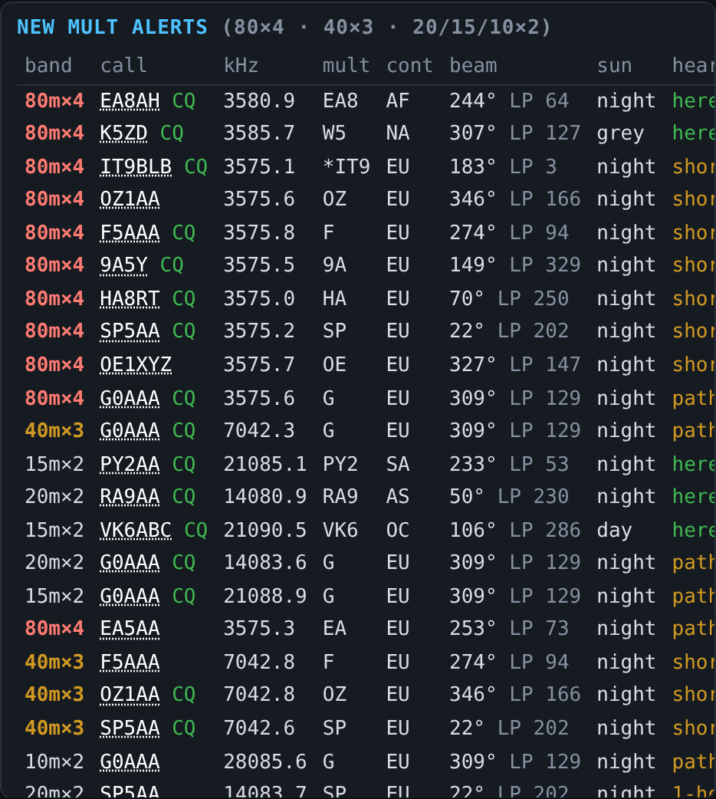 |
| **Where to point & which band** — heatmap, beam chart, ranked bands | **New mult alerts** with the *heard* column |
| 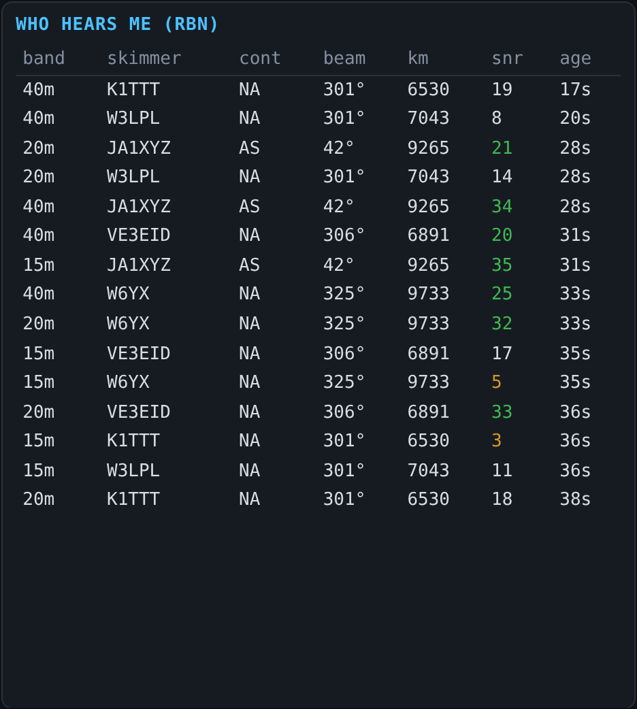 | 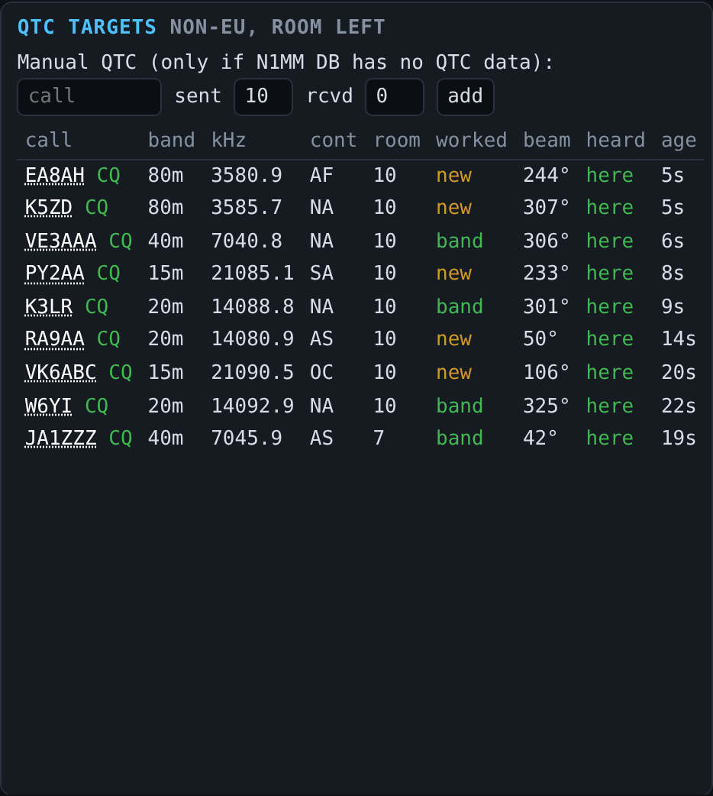 |
| **Who hears me** — RBN skimmers decoding your call | **QTC targets** — non-EU stations with QTC room |

The four images above and the full view below come from [demo mode](#try-it-without-a-radio-demo-mode)
(simulated data).

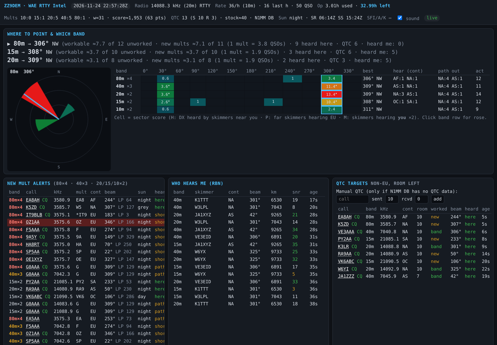

**From the real contest** — S51A, Sunday 15 Nov 2026, 21:12 UTC. These panels were re-drawn from a photo
of the live screen; every value is exactly as it was on screen (rows 11–26 and rank 1 were scrolled off).

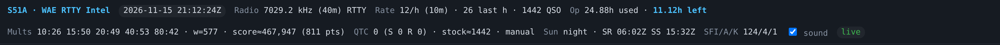
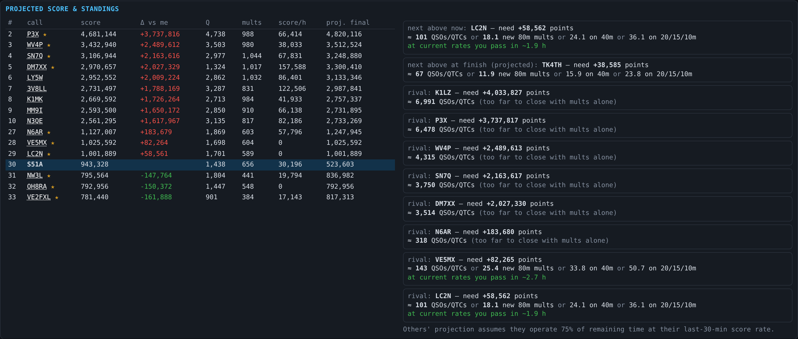
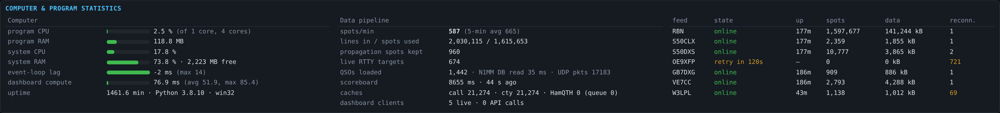

Clicking a call tunes the radio and opens the details pop-up:

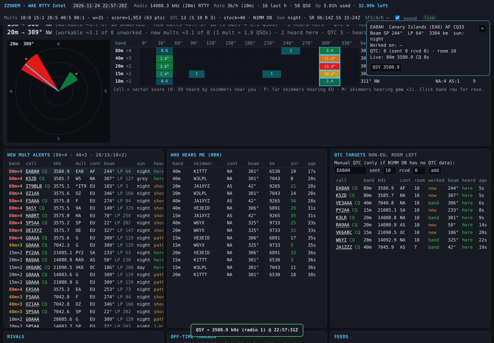

## How it works

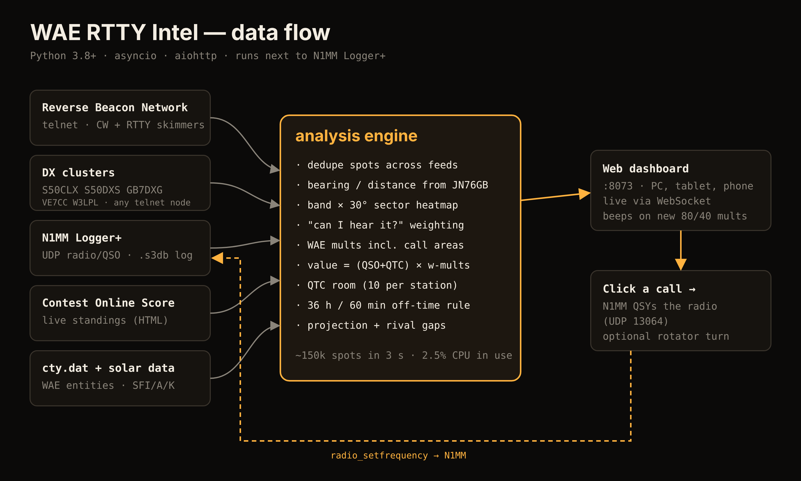

1. **Spot feeds** — telnet connections to RBN (port 7000: CW + RTTY skimmers) and any number of
   DX-cluster nodes (DXSpider, AR-Cluster, CC Cluster all work). Each line is parsed
   (`DX de SPOTTER: FREQ CALL COMMENT HHMMZ`); RBN comments give mode, SNR, speed and CQ.
   Spots without a mode are classified by frequency (RTTY segments; FT8 watering holes are excluded).
2. **Geography** — every call is resolved with `cty.dat` to an entity, continent and position
   (big countries are refined by call area, e.g. W6 vs W1). Bearing and distance are computed from
   your locator.
3. **Propagation evidence** — only spots that say something about *your* paths are kept (near skimmer
   hearing DX, far skimmer hearing a station near you, anyone hearing you) — this keeps memory and CPU
   low even with 100+ spots per second.
4. **Your log** — from N1MM: UDP *Contacts* broadcasts (instant) and a read-only poll of the N1MM
   `.s3db` database every 10 s (complete log, survives restarts, QTCs). N1MM *Radio* broadcasts give
   your frequency and TX state.
5. **Scoreboard** — the Contest Online Scoreboard HTML page is fetched every 60 s and parsed; your row is
   found by call or operator call (e.g. `S51A (S58Q)`); your category is filtered by words
   (`SO HP` matches `SO-ALL HP DIGI`).
6. **Analysis** — every 5 s a snapshot is computed (≈50–80 ms on an old PC) and pushed to all open
   browsers over a WebSocket.
7. **Control** — clicking a call sends N1MM a `radio_setfrequency` message on UDP 13064 (the mechanism
   the Waterfall Bandmap uses); optional rotator commands go to PstRotator/N1MM Rotor.

## Requirements

- **Python 3.8 or newer** (3.8 is the last version that runs on Windows 7 — that is why the code stays
  3.8-compatible).
- Python packages: `aiohttp` (required), `tomli` (only on Python < 3.11), `psutil` (optional — system
  CPU/RAM in the statistics panel). Installed with `pip install -r requirements.txt`.
- **`cty.dat`** country file — the *Big CTY* version from [country-files.com](https://www.country-files.com).
- Internet access for RBN, clusters, scoreboard and solar data.
- A modern browser (Chrome/Edge/Firefox; on Windows 7 Chrome 109 or Firefox ESR 115 work).
- **N1MM Logger+** is strongly recommended but optional. Without it the program still shows
  propagation, headings, alerts and standings; it just doesn't know your log.

Windows, Linux and macOS are supported. The N1MM integration only matters on the PC that runs N1MM
(Windows), but the dashboard itself can run anywhere that can reach the internet and N1MM's UDP
broadcasts.

## Quick start

```bash
git clone https://github.com/aljaz2008/wae-rtty-software.git
cd wae-rtty-software
python -m pip install -r requirements.txt
cp config.example.toml config.toml        # Windows: copy config.example.toml config.toml
#   edit config.toml: set [station] call and grid
#   put cty.dat (Big CTY, from country-files.com) next to config.toml
python wae_intel.py --check               # shows what will be used
python wae_intel.py                       # then open http://localhost:8073
```

## Try it without a radio (demo mode)

```bash
python demo/run_demo.py
```

Opens the whole dashboard at <http://localhost:8073> with **simulated** spots, a fake N1MM database
(QSOs + QTCs), a fake scoreboard and fake radio data — everything on your own computer, no N1MM and no
internet needed. Useful to learn the panels before the contest. See [demo/README.md](demo/README.md).

## Installation, step by step

### 1. Install Python

- **Windows 10/11:** install Python 3.11+ from [python.org](https://www.python.org/downloads/windows/).
  Tick **"Add python.exe to PATH"** on the first installer screen.
- **Windows 7:** install **Python 3.8.10** (the last official Windows 7 installer; 64-bit
  *"Windows x86-64 executable installer"*, or x86 on 32-bit Windows). Needs Windows 7 SP1; the installer
  may ask for update KB2533623. Tick **"Add Python 3.8 to PATH"**.
- **Linux:** use your distribution's `python3` (3.8+) and `python3-pip`.
- **macOS:** `brew install python` or the python.org installer.

Check: `python --version` (on Linux/macOS maybe `python3 --version`).

### 2. Get the program

Either `git clone https://github.com/aljaz2008/wae-rtty-software.git`, or on GitHub click
**Code → Download ZIP** and unzip it, e.g. to `C:\wae-rtty-software`.

### 3. Install the packages

```bash
cd wae-rtty-software
python -m pip install -r requirements.txt
```

On old Windows installations pip sometimes fails with SSL/certificate errors; this usually helps:

```bash
python -m pip install --trusted-host pypi.org --trusted-host files.pythonhosted.org -r requirements.txt
```

If only `psutil` fails to install, ignore it — it is optional.

### 4. Get the country file

Download **Big CTY** from [country-files.com](https://www.country-files.com), unzip it and copy
**`cty.dat`** (only that file) next to `config.toml`. Check it contains the WAE entities: search the
file for `*IT9`. If `cty.dat` is missing, the program falls back to N1MM's own
`Documents\N1MM Logger+\SupportFiles\wl_cty.dat` when it exists.

### 5. Configure

```bash
cp config.example.toml config.toml        # Windows: copy config.example.toml config.toml
```

Open `config.toml` in a text editor and set at least:

```toml
[station]
call = "S51A"          # the call you transmit
grid = "JN76GB"        # your locator
aliases = ["S58Q"]     # e.g. the operator call when using a club call
```

Recommended as well: `[scoreboard] category` (your class, e.g. `"SO HP"`) and the
`expected_final_points` / `expected_final_wmults` estimates from your previous WAE RTTY result.
Contest dates are computed automatically (second full weekend of November). Every option is explained
in the file itself and in the [configuration reference](#configuration-reference).

### 6. Check and run

```bash
python wae_intel.py --check
python wae_intel.py
```

`--check` prints the station, the contest window, which `cty.dat` and N1MM database will be used, the
feeds and the web address, and exits with an error message if something is wrong. Then start the program
and open **http://localhost:8073**. Leave the console window open — closing it stops the program.
Stop it with **Ctrl+C**; nothing is lost, the log is reloaded from N1MM on the next start.

## Connecting N1MM Logger+

### Broadcasts (radio + QSOs)

In N1MM: **Config → Configure Ports, Mode Control, Winkey, etc. → Broadcast Data**

1. Tick **Radio** and **Contacts**.
2. Set their address to `127.0.0.1:12060`. If another program already uses an address there, add ours
   after a space, e.g. `127.0.0.1:12061 127.0.0.1:12060`.
3. If port 12060 is already in use on your PC, use another port in both N1MM and
   `[n1mm] udp_port`.

The top bar then shows your radio frequency, and each logged QSO appears immediately.

### The log database (complete log + QTCs)

N1MM keeps its log in an SQLite file (`Documents\N1MM Logger+\Databases\*.s3db`). The program reads it
**read-only** every 10 s. With `db_path = "auto"` it searches that folder and picks the database that
contains the most QSOs of this contest inside the contest window (at a club station with many contest
logs, "newest file" is often the wrong one). To be explicit:

```toml
[n1mm]
db_path = 'C:\Users\you\Documents\N1MM Logger+\Databases\WAE_RTTY_2026.s3db'   # single quotes!
contest_like = "WAE%"     # N1MM calls WAE RTTY "WAERTTY"
```

Check what the program sees:

```bash
python wae_intel.py --inspect-db
```

It prints every table and column, a few sample rows, the number of WAE QSOs and the detected QTC table
mapping. Send that output in an issue if QSOs or QTCs are not recognised.

If N1MM ever reports *"database is locked"*, set `db_mode = "copy"`: the program then reads a copy of
the file and never touches N1MM's original.

### Click-to-QSY

Nothing to configure in most cases: clicking an underlined call sends N1MM

```xml
<radio_setfrequency><app>WAE-Intel</app><radionr>1</radionr><frequency>14085.300</frequency><mousebutton>Left</mousebutton></radio_setfrequency>
```

to `127.0.0.1:13064`. A message at the bottom of the page confirms it (`QSY → 14085.3 kHz (radio 1)`).
It is refused while N1MM reports that you are transmitting. If you use AFSK and the radio lands a bit off
the signal, put the error into `qsy_offset_khz`. If nothing happens, look in N1MM's Broadcast Data tab for
an option to accept incoming UDP commands, and check that no firewall blocks local UDP.

### Rotator (optional)

```toml
[control]
rotator = "pstrotator"     # sends <PST><AZIMUTH>az</AZIMUTH></PST> to UDP 12000
# rotator = "n1mmrotor"    # sends an <N1MMRotor> message to UDP 12040 (set rotator_name)
rotate_on_click = true     # clicking a call also turns the beam (short path)
```

The call pop-up then gets **Beam SP**, **Beam LP** and **QSY + beam** buttons. Rotator commands are also
refused while transmitting. These message formats were not tested against real rotator software during
the 2026 contest — try them before you rely on them.

## Configuration reference

All settings live in `config.toml` (TOML format). Anything you leave out uses the default shown here.

### `[station]`

| key | default | meaning |
|---|---|---|
| `call` | — (required) | the call you transmit |
| `grid` | — (required) | your Maidenhead locator, 4 or 6 characters |
| `aliases` | `[]` | other calls you may appear under on the scoreboard (operator call) |
| `login_call` | = `call` | call used to log in to RBN and clusters |

### `[contest]`

| key | default | meaning |
|---|---|---|
| `start_utc` / `end_utc` | `"auto"` | `auto` = this year's WAE RTTY (2nd full weekend of November, Sat 00:00 – Sun 23:59 UTC), or ISO times like `"2026-11-14T00:00:00Z"` |
| `max_operating_hours` | `36` | single-operator operating-time limit |
| `min_off_minutes` | `60` | minimum off period |

### `[analysis]`

| key | default | meaning |
|---|---|---|
| `window_min` | `15` | minutes of spots used for the heatmap and "who hears me" |
| `sector_deg` | `30` | sector width; 360 must be divisible by it |
| `near_km` | `1200` | a skimmer this close is "what you can hear" |
| `far_km` | `2500` | a skimmer this far hearing your area means "the path is open" |
| `local_km` | `400` | skimmers closer than this (ground wave) are ignored for direction |
| `alert_max_age_min` | `10` | older spots drop out of alerts and targets |
| `expected_final_points` | `2500` | your expected final QSOs + QTCs (used during the first 3 h) |
| `expected_final_wmults` | `800` | your expected final weighted multipliers (80m×4 + 40m×3 + others×2) |
| `qtc_value` | `0.3` | value of one QTC vs one QSO, in operating-time terms (band ranking) |
| `mult_decay_hours` | `8.0` | how fast your multiplier rate fades in the projection |
| `rtty_only` | `true` | alerts/targets only for RTTY spots |
| `propagation_all_modes` | `true` | use CW skimmer data for the heatmap too |
| `rtty_segments` | see file | kHz ranges used to classify spots without a mode |

### `[files]`

| key | default | meaning |
|---|---|---|
| `cty` | `"cty.dat"` | country file |
| `qtc_ledger` | `"qtc_ledger.json"` | where manual QTC entries are saved |
| `skimmers_csv` | `"skimmers.csv"` | optional `CALL,GRID` lines for exact skimmer positions |

### `[web]`

| key | default | meaning |
|---|---|---|
| `host` | `"127.0.0.1"` | `"0.0.0.0"` to allow other devices on your network |
| `port` | `8073` | dashboard port |
| `push_seconds` | `5` | how often the dashboard updates |

### `[n1mm]`

| key | default | meaning |
|---|---|---|
| `udp_enabled` | `true` | listen for N1MM broadcasts |
| `udp_host` / `udp_port` | `"0.0.0.0"` / `12060` | where to listen |
| `db_path` | `"auto"` | N1MM `.s3db`, `"auto"`, or `""` to disable |
| `db_poll_seconds` | `10` | database read interval |
| `db_mode` | `"direct"` | `"copy"` reads a copy of the file (zero locking) |
| `contest_like` | `"WAE%"` | SQL pattern for N1MM's contest name |

`[n1mm.qtc]` — override the QTC table detection only if `--inspect-db` shows a wrong guess:
`table`, `call_col` (the station you exchanged QTCs with), `dir_col` (sent/received flag), `time_col`.

### `[control]`

| key | default | meaning |
|---|---|---|
| `qsy_on_click` | `true` | clicking a call tunes the radio via N1MM |
| `n1mm_host` / `n1mm_port` | `"127.0.0.1"` / `13064` | where N1MM listens for commands |
| `radio_nr` | `"active"` | which radio to tune (`1`, `2` for SO2R) |
| `qsy_offset_khz` | `0.0` | correction added to every QSY |
| `block_while_transmitting` | `true` | never QSY or rotate while transmitting |
| `rotator` | `"none"` | `"pstrotator"` or `"n1mmrotor"` |
| `rotator_host` / `rotator_port` | `127.0.0.1` / 12000 or 12040 | rotator software address |
| `rotator_name` | `""` | rotor name for N1MM Rotor |
| `rotate_on_click` | `false` | clicking a call also turns the beam |

### `[scoreboard]`

| key | default | meaning |
|---|---|---|
| `url` | Contest Online Scoreboard, contest 101 | `""` disables standings and auto-rivals |
| `poll_seconds` | `60` | refresh interval (please keep it ≥ 60 s) |
| `category` | `""` (everyone) | your class as words, e.g. `"SO HP"`; `S/O` = `SO`; single-band classes only match if you name a band |
| `rival_duty_cycle` | `0.75` | share of the remaining time others are assumed to operate |

### `[rivals]`

| key | default | meaning |
|---|---|---|
| `calls` | `[]` | always-tracked rivals |
| `auto` | `true` | add rivals from the scoreboard |
| `auto_top` | `5` | top N of your category |
| `auto_around` | `3` | N stations directly above and below you |

### `[solar]`, `[hamqth]`

`[solar] url` — HamQSL XML feed for SFI/A/K (`""` disables).
`[hamqth] user` / `password` — optional free [HamQTH](https://www.hamqth.com) account for exact
locations of rivals, clicked calls and (with `lookup_skimmers = true`) skimmers.

### `[[feeds]]`

One block per telnet feed:

```toml
[[feeds]]
name = "RBN"
host = "telnet.reversebeacon.net"
port = 7000
enabled = true
# login = "N0CALL"          # optional, defaults to login_call / call
# password = ""             # if the node asks for one
# init = ["set/noskimmer"]  # commands sent after login
# stale_seconds = 600       # reconnect if nothing arrives for this long
```

If you delete all `[[feeds]]` blocks, a built-in list is used (RBN, S50CLX, S50DXS, GB7DXG, VE7CC,
W3LPL). More feeds mean more human spots but also more CPU — RBN alone already provides most of the
skimmer data.

## Using the dashboard

**Top bar** — UTC time · radio frequency (from N1MM) · rate (10-min ×6 / last hour / total QSOs) ·
operating time used and left · multipliers per band, weighted total `w=` and estimated score · QTCs
(sent/received, QSOs still available to send, source) · sun at your QTH with sunrise/sunset ·
SFI/A/K · sound on/off · connection state.

**Where to point & which band**
- The ▶ line is the recommendation: `80m → 308° NW (workable ≈5.9 of 9 unworked · new mults ≈5.9 of 9
  (1 mult = 12.5 QSOs) · 8 heard here · QTC 6 · heard me: 0)`. "≈5.9 of 9" means 9 unworked stations are
  spotted, and after weighting by audibility about 5.9 are realistically workable.
- In the heatmap each row is a band, each column a direction; brighter = more evidence; ★ = skimmers in
  that direction decode you; the outlined cell is the best direction. Hover a cell for H/P/M counts.
- *hear (cont)* = continents you can hear; *path out* = continents hearing your area.
- Click a band row to draw its beam chart.

**New mult alerts** — red = 80 m ×4, orange = 40 m ×3. Work the green `here` rows first; `far` rows are
greyed out. `sp` = number of skimmers (`+h` = also spotted by a person). `≈QSO` = what this multiplier is
worth right now.

**Who hears me** — fills only while you call CQ. Green SNR (≥20 dB) = you are loud there.

**QTC targets** — `room` = QTCs left with that station; `worked: band` = you only need to send QTCs,
`new` = a QSO and QTCs in one contact. Use the manual QTC box only if your N1MM database provides no QTC
data.

**Rivals / Projected score & standings** — rank now and projected finish; for each target station the
points you need, as QSOs/QTCs or as 80/40/20 m multipliers, and when you pass them at current rates.
Your own projection extends your scoreboard score with its measured rate; others are assumed to operate
`rival_duty_cycle` of the remaining time.

**Off-time tracker** — the current gap turns amber at 40 min and green ("counts as OFF") at 60 min.
Leave a margin: don't log anything before ~62 minutes.

**Feeds / statistics** — a feed on `retry` cannot connect; a red lag or compute bar means the PC is
overloaded (disable some cluster feeds).

## Command line

```text
python wae_intel.py [config.toml] [--check] [--inspect-db] [--version]

  config.toml     path to the configuration (default: ./config.toml)
  --check         validate the configuration, print what will be used, exit
  --inspect-db    print the N1MM database tables and the detected QSO/QTC mapping, exit
  --version       print the version
```

HTTP endpoints (for your own tools): `GET /api/snapshot` (everything the dashboard shows, JSON),
`GET /api/lookup?call=XX1XX`, `POST /api/qsy` `{"freq": 14085.3, "azimuth": 300, "rotate": false}`,
`POST /api/qtc` `{"call": "W1AW", "sent": 10, "rcvd": 0}`, WebSocket `/ws`.

## Open it on a phone or tablet

Set `[web] host = "0.0.0.0"`, restart, allow the program through the firewall on *private* networks, and
open `http://<PC-IP>:8073` (find the IP with `ipconfig` / `ip addr`). Anyone on that network can then also
use click-to-QSY, so only do this on your own network.

## Troubleshooting

| symptom | fix |
|---|---|
| `error: configuration problems` | read the list it prints; usually `call` or `grid` not set |
| `cty file not found` | put Big CTY `cty.dat` next to `config.toml` |
| `n1mm_udp: error … address in use` | another program uses 12060: change `udp_port` here and in N1MM |
| Radio shows `—` | N1MM Broadcast Data → Radio not ticked or wrong address |
| QSO count is 0 / wrong | run `--inspect-db`; set `db_path` explicitly; check `contest_like` |
| `n1mm_db_warn: DB has 0 QSOs …` | the database or contest name doesn't match this contest — the live UDP log is kept |
| N1MM says "database is locked" | `db_mode = "copy"` |
| QTCs stay at 0 | see [known limitations](#known-limitations); use the manual QTC box and send `--inspect-db` output in an issue |
| Click does nothing | press Ctrl+F5 in the browser (old page cached); check the confirmation message; see [Click-to-QSY](#click-to-qsy) |
| A feed stays on `retry` | the node is down or the address changed: `enabled = false` |
| `scoreboard: 0 rows` / you are missing | wrong `url`, or your row uses another call: add it to `aliases`; check `category` words |
| Lag/compute bar red | disable some cluster feeds (RBN alone is enough) |
| pip SSL errors on Windows 7 | use the `--trusted-host` command above |

## Known limitations

Honest list — this was built in one evening and hardened during one contest.

- **QTC reading from N1MM is unverified.** The program looks for a table whose name contains "QTC" and
  guesses the columns. During WAE RTTY 2026 it did **not** find the QTCs in N1MM's real database (N1MM
  showed 73 received QTCs on 40 m; the dashboard showed 0 all weekend), so the local score estimate was
  about half of the real score. The standings use the scoreboard and were not affected. If you can share
  `--inspect-db` output from a log with QTCs, the mapping can be fixed.
- **Click-to-QSY uses N1MM's `radio_setfrequency` UDP command**, which is described in the N1MM user community as a "not fully supported" control feature; if a future N1MM version changes it, clicks will do nothing.
- **Rotator messages** (PstRotator, N1MM Rotor) were implemented from their documented formats but not
  tested with real hardware.
- **Scoreboard parsing reads the HTML page**, because I found no documented public API for Contest Online
  Scoreboard. A change to the page layout can break it; the program then simply shows no standings.
- **Skimmer coverage decides everything.** Where few skimmers are near you, `here` evidence is thin and
  the tool leans on `path` evidence. Positions come from `cty.dat` (country or call-area centroid) unless
  HamQTH or `skimmers.csv` gives exact grids.
- Only short-path headings are used for the heatmap; long-path openings are not detected separately.
- WAE RTTY only — the scoring and multiplier rules are specific to this contest.

## Field report: WAE RTTY 2026 at S51A

Used through WAE DX Contest RTTY 2026 (14–15 Nov) at the **S51A** contest station (operator **S58Q**,
JN76GB, class SO-ALL HP DIGI on the scoreboard), on a Windows 7 PC next to N1MM Logger+.

Snapshot on Sunday 15 Nov, 21:12 UTC (from a photo of the dashboard):

- Scoreboard: **943,328** points, **1,438** QSOs, **656** multipliers, 30th in the filtered SO HP list.
  Next above: LC2N, +58,562 points ≈ 101 QSOs/QTCs or 18.1 new 80 m multipliers.
- Log: 1,442 QSOs; multipliers 80 m 42 · 40 m 53 · 20 m 49 · 15 m 50 · 10 m 26 → weighted 577;
  24.88 h of 36 h used. SFI/A/K 124/4/1.
- Program after **1,461.6 minutes of continuous running**: 2.5 % of one core, 118.8 MB RAM, event-loop lag
  max 14 ms, dashboard compute ≈52 ms average; 2,030,115 telnet lines read, 1,615,653 spots used,
  ≈600 spots/min; RBN alone delivered 1.6 million spots (141 MB).

What went wrong, and what changed because of it:

1. The first "auto" database finder took the *newest* `.s3db`, which was another contest's log →
   it now picks the database that actually contains this contest.
2. The scoreboard lists the station as `S51A (S58Q)`, which the first parser ignored → station
   (operator) parsing and `aliases`.
3. QTCs were never read from N1MM → still open, see limitations.
4. The local projection started from the QTC-less estimate and projected *below* the score already on
   the scoreboard → your projection now extends the scoreboard score.
5. One cluster (OE9XFP) never connected in 48 h → disabled in the example config.

## Project layout

```text
wae_intel.py            entry point (python wae_intel.py)
config.example.toml     annotated configuration template -> copy to config.toml
requirements.txt
waeintel/
  app.py                startup, web server, WebSocket push, CLI (--check, --inspect-db)
  config.py             config loading, defaults, WAE date calculation, validation
  spots.py              spot parsing, telnet feeds with auto-reconnect
  cty.py                cty.dat parser and call -> entity lookup (WAE entities, call areas)
  geo.py                locator, bearing/distance, sun elevation, sunrise/sunset
  analytics.py          state, heatmap, audibility, WAE scoring, alerts, QTC, off-time, projection
  n1mm.py               N1MM UDP listener, database reader, --inspect-db
  external.py           scoreboard (HTML/JSON/XML), solar data, HamQTH
  control.py            click-to-QSY and rotator commands
  sysstats.py           CPU/RAM statistics (psutil optional, Windows 7 safe)
  static/index.html     the dashboard (single file, no build step)
demo/
  run_demo.py           simulated feeds/DB/scoreboard for trying it without a radio
  cty_sample.dat        tiny country file for demo and tests
tests/                  pytest unit tests
docs/images/            screenshots and diagram
```

## Development

```bash
python -m pip install pytest
python -m pytest -q          # unit tests (parsing, cty, call-area mults, scoreboard, off-time …)
python demo/run_demo.py      # full system on simulated data
```

Code style: plain Python 3.8-compatible (`from __future__ import annotations`), asyncio, no framework
beyond aiohttp, the dashboard is one static HTML file. Pull requests welcome — especially a verified
N1MM QTC table mapping.

## Credits and data sources

- [Reverse Beacon Network](https://www.reversebeacon.net) — skimmer spots.
- DX-cluster sysops of the nodes in the default list (list based on
  [DXLab's list of RBN-carrying clusters](https://dxlabsuite.com/dxlabwiki/CollectingSpotsRBN)).
- [country-files.com](https://www.country-files.com) (AD1C) — `cty.dat`.
- [Contest Online Scoreboard](https://contestonlinescore.com) — live standings.
- [HamQSL](https://www.hamqsl.com) (N0NBH) — solar data.
- [HamQTH](https://www.hamqth.com) — optional callsign locations.
- [N1MM Logger+](https://n1mmwp.hamdocs.com) — the logger this integrates with.
- Contest: [WAE DX Contest](https://www.darc.de/der-club/referate/conteste/wae-dx-contest/en/) by DARC.

Please be gentle with these free services: keep the scoreboard poll at 60 s or more and don't add
feeds you don't need.

## Contest rules and fair use

This is an unofficial helper, not affiliated with DARC. Its alerts and standings are built from spotting
networks and online scores: **check the current WAE rules for your category** on the use of spotting
assistance before you use it in a contest, and log the QSOs yourself in your logger as usual.

## License

[MIT](LICENSE) © 2026 Aljaž Žugič Jehart, S58Q — [s58q.eu](https://s58q.eu)
